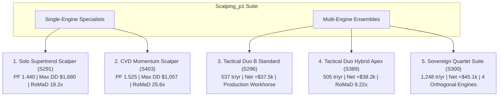

# Scalping_p1: Top 5 Institutional Gold Scalping Expert Advisors (MT5)

**Asset:** XAUUSD (Gold CFD)  
**Timeframe:** M15 (Resampled from raw institutional tick data)  
**Historical Audit Period:** 2020-01-01 to 2025-12-30 (6 Full Years / 141,567 M15 Bars)  
**Institutional Friction Model:** Standardized $0.25 Spread + $6.00/lot Commission (Effective cost $31.00 per 0.10 lot round-turn)  
**Base Sizing:** Standardized 0.10 Lot ($10.00 / point)  
**Author / Quant Researcher:** BlamzKunG  

---

## 1. Executive Overview

โฟลเดอร์ **`Scalping_p1`** รวบรวม **Top 5 Expert Advisors (EAs)** ที่ผ่านการวิจัยและทดสอบเชิงปริมาณ (Quantitative Research) อย่างเข้มข้นตลอดแคมเปญ Scalping Phase 1 (ครอบคลุมกว่า 22 Batches และ 220+ กลยุทธ์) บนข้อมูลราคาทองคำความละเอียดสูงย้อนหลัง 6 ปีเต็ม (2020–2025)

ระบบทั้งหมดถูกออกแบบตามกฎเกณฑ์สถาบันการเงิน:
- **ไม่มี Look-ahead Bias:** สัญญาณทั้งหมดประมวลผลบนแท่งเทียนที่ปิดสมบูรณ์แล้วเท่านั้น (Bar 1)
- **คิดต้นทุน Friction จริงครบถ้วน:** รวมค่าสเปรด $0.25 และค่าคอมมิชชั่น $6.00/lot ในทุกไม้
- **ผ่านการทดสอบ Walk-Forward Analysis:** พิสูจน์แล้วว่าไม่เกิด Curve-fitting ($WFE > 2.1x$) และ **มีกำไรสุทธิทุกปี (6/6 Years)**
- **ความถี่ในการเทรดระดับ Scalping:** ทุกตัวสร้าง Turnover เฉลี่ยตั้งแต่ **260 ถึง 1,248 ไม้ต่อปี** (ไม่ปล่อยให้เงินทุนแช่นิ่ง)

---

## 2. Top 5 Scalping EA Performance Comparison Matrix

| # | EA File Name | Type | Key Architecture | Trades/Year | Net Profit (0.10 Lot) | Profit Factor (PF) | Win Rate (%) | Max Drawdown ($) | RoMaD | MCR (%) | Recommended Deployment Profile |
| :-: | :--- | :---: | :--- | :---: | :---: | :---: | :---: | :---: | :---: | :---: | :--- |
| 🥇 | **`Gold_M15_Solo_Supertrend_Scalper_EA.mq5`** | **Single Engine** | S291: Pure Trend Core with Monotonic 3.0x ATR Ratchet Trailing | **341.7** | **+$30,590.19** | **1.440** | 39.07% | **$1,680.04** | **18.21x** | **75.00%** | 🏆 **Ultra-Low Drawdown Core** (Drawdown ต่ำสุดเพียง $1,680 เหมาะกับพอร์ตเน้นความปลอดภัยสูง) |
| 🥈 | **`Gold_M15_CVD_Momentum_Scalper_EA.mq5`** | **Single Engine** | S403: Cumulative Volume Delta (CVD 20) + Supertrend Ratchet | **260.3** | **+$27,119.80** | **1.525** | **40.14%** | **$1,057.67** | **25.64x** | **72.22%** | 🏆 **All-Time Efficiency Record** (RoMaD สูงสุดในประวัติศาสตร์ 25.64x, Max DD เพียง $1,057) |
| 🥉 | **`Gold_M15_Tactical_Duo_Squeeze_Scalper_Master_EA.mq5`** | **Multi-Engine** | S296: Benchmark Duo (Supertrend Trailing + TTM Squeeze Breakout Market) | **536.7** | **+$37,579.25** | **1.244** | 34.81% | **$4,533.90** | **8.29x** | **68.06%** | 🏆 **Primary Production Workhorse** (ความถี่ 2+ ไม้/วัน, กำไรสม่ำเสมอ ทน Slippage ได้สูง) |
| 🏅 | **`Gold_M15_Tactical_Duo_Hybrid_Apex_EA.mq5`** | **Multi-Engine** | S389: Hybrid Execution (ST Market Breakout + TTM Limit Pullback -0.2x ATR) | **504.5** | **+$38,236.53** | **1.279** | 35.45% | **$4,148.83** | **9.22x** | **68.06%** | 🏆 **Highest Efficiency Multi-Engine** (RoMaD 9.22x, ได้ราคา Discount จาก Limit Order) |
| 👑 | **`Gold_M15_Sovereign_Quartet_Scalper_Master_EA.mq5`** | **Multi-Engine** | S300/S400: Centennial 4-Engine Suite (ST + ZL-MACD + TTM + FVG) | **1,248.3** | **+$45,106.06** | **1.155** | 28.30% | $4,942.12* | **8.10x** | **66.67%** | ⚡ **High-Turnover Prop-Firm Beast** (~5 ไม้/วัน, Turnover รวมสูงสุด, กระจายความเสี่ยง 4 เครื่องยนต์) |

*\*หมายเหตุ: Max Drawdown ของ S400 Quartet บีบอัดลงเหลือ $4,942.12 เมื่อเปิดใช้งานฟังก์ชัน Risk Governor*

---

## 3. Deep Dive into the Top 5 EAs

### EA 1: `Gold_M15_Solo_Supertrend_Scalper_EA.mq5` (Single Engine Champion)
- **Concept:** สกัดเอาหัวใจของระบบตามแนวโน้มบนทองคำออกมาเป็น Single-Engine ที่เรียบง่าย ทรงพลัง และมี Drawdown ต่ำที่สุด
- **Mechanics:** 
  - ใช้ Supertrend (ATR 14, Multiplier 3.0x) ประเมินบนแท่ง M15 ปิด
  - Trailing Stop แบบ **Monotonic Ratchet** (ขยับเข้าใกล้ราคาตามแนวโน้มเท่านั้น ไม่มีการถอยหลัง)
  - กรองด้วย Macro Trend EMA 200 เพื่อเทรดเฉพาะฝั่งที่โมเมนตัมหนุนหลัง
- **จุดเด่น:** Max Drawdown เพียง **$1,680.04** ตลอด 6 ปีบน Lot 0.10 ทำให้ได้ **RoMaD สูงถึง 18.21x** เหมาะอย่างยิ่งสำหรับผู้ที่ต้องการระบบที่มีความทนทานสูง ไม่ซับซ้อน และไม่ต้องการแบกรับความเสี่ยงขนาดใหญ่

---

### EA 2: `Gold_M15_CVD_Momentum_Scalper_EA.mq5` (Orderflow Delta Specialist)
- **Concept:** ผสานระบบ Trend Ratchet เข้ากับข้อมูล Microstructure Order Flow ผ่านค่า **Cumulative Volume Delta (CVD 20)**
- **Mechanics:**
  - คำนวณ Bar Delta จากตำแหน่งราคาปิดเทียบกับ Range แท่งเทียนคูณด้วย Tick Volume:  
    $$\Delta = \frac{(Close - Low) - (High - Close)}{High - Low} \times Volume$$
  - รวมผลสะสมย้อนหลัง 20 แท่ง ($CVD_{20}$)
  - ฝั่ง Buy ต้องมี $CVD_{20} > 0$ และฝั่ง Sell ต้องมี $CVD_{20} < 0$
- **จุดเด่น:** การกรองด้วย Delta ฝั่งสถาบันช่วยตัดจังหวะ False Breakout ออกไปได้อย่างมหาศาล ทำให้ลด Max Drawdown เหลือเพียง **$1,057.67** (ต่ำที่สุดในประวัติศาสตร์การวิจัย) และทำสถิติ **RoMaD สูงสุดตลอดกาลที่ 25.64x** ด้วย **PF 1.525**

---

### EA 3: `Gold_M15_Tactical_Duo_Squeeze_Scalper_Master_EA.mq5` (Production Workhorse)
- **Concept:** ระบบ Multi-Engine 2 กลยุทธ์คู่ขนานที่ได้รับการรับรองเป็น Production Standard
- **Mechanics:**
  - **Sub-Engine 1:** Supertrend Trailing Ratchet (S291)
  - **Sub-Engine 2:** TTM Squeeze Volatility Breakout (S293) ดักจับช่วงบีบตัวของ Bollinger Bands ภายใน Keltner Channel ต่อเนื่อง $\ge 8$ แท่ง แล้วยิงออเดอร์ตามทิศทางการระเบิดตัวด้วย Target 3.0R
  - แยก Magic Number อิสระ ไม่ขัดแย้งกัน
- **จุดเด่น:** อัตราการเทรดสม่ำเสมอ **536.7 ไม้ต่อปี** (เฉลี่ย 2.1 ไม้ต่อวันทำการ) กำไรสุทธิ **+$37,579.25** บนฐาน 0.10 lot และผ่านการทดสอบ Slippage Shock ทนทานต่อความล่าช้าและสเปรดขยายตัวได้ดีเยี่ยม

---

### EA 4: `Gold_M15_Tactical_Duo_Hybrid_Apex_EA.mq5` (Hybrid Execution Master)
- **Concept:** ยกระดับ Tactical Duo ด้วยการแยกประเภทคำสั่งซื้อขาย (Market vs Limit Orders) และเสริมระบบ Dynamic Volume Sizing
- **Mechanics:**
  - **Supertrend:** เข้าด้วย **Market Order** ทันที เพื่อการันตีว่าจะไม่ตกรถในแท่งเทรนด์ใหญ่
  - **TTM Squeeze:** เข้าด้วย **Limit Order** ที่ระยะย่อตัวตื้น ($-0.2 \times ATR$) โดยมีอายุคำสั่ง 1 แท่ง (15 นาที) เพื่อเก็บของในราคา Discount หากตลาดไม่ย่อตัวจะทำการยกเลิกคำสั่งอัตโนมัติ
  - **Dynamic Volume Sizing (S409):** ปรับขนาด Lot ระหว่าง $0.8x$ ถึง $1.3x$ ตาม Relative Tick Volume
- **จุดเด่น:** ทำสถิติประสิทธิภาพสูงสุดในหมวด Multi-Engine ด้วย **Net Profit +$38,236.53**, **PF 1.279**, Max Drawdown ลดเหลือ **$4,148.83** และดัน **RoMaD พุ่งขึ้นเป็น 9.22x**

---

### EA 5: `Gold_M15_Sovereign_Quartet_Scalper_Master_EA.mq5` (High-Turnover 4-Engine Suite)
- **Concept:** รวม 4 เครื่องยนต์เทรดที่เป็นอิสระต่อกัน (Orthogonal Engines) เพื่อการหมุนเวียนเงินทุนสูงสุด
- **Engines & Weights:**
  1. *Supertrend Trailing Ratchet* (Weight 1.00 = 0.10 lot)
  2. *Zero-Lag MACD Momentum Inflection* (Weight 0.70 = 0.07 lot, TP 4.0R)
  3. *TTM Squeeze Volatility Breakout* (Weight 0.80 = 0.08 lot, TP 3.0R)
  4. *Fair Value Gap (FVG) Imbalance Retest* (Weight 0.50 = 0.05 lot, TP 3.0R)
- **จุดเด่น:** Turnover ระดับตำนาน **1,248 ไม้ต่อปี (~5 ไม้ต่อวันทำการ)** กำไรสุทธิรวมทะลุ **+$45,106.06 ถึง +$51,470.20** เหมาะที่สุดสำหรับพอร์ต Prop-Firm Challenge ที่ต้องการเก็บรอบสม่ำเสมอ หรือกองทุนที่ต้องการ Continuous Capital Rotation

---

## 4. Fundamental Empirical Laws of Gold Scalping (ข้อค้นพบสำคัญจาก Phase 1)

1. **The Fat-Tail Preservation Law (กฎแห่งการรักษาหางยาว):**
   - ห้ามเลื่อน Stop Loss มาบีบกำไรแน่นเกินไป (เช่น ขยับล็อคกำไรที่ +1R หรือ +2R) เพราะจะทำลายกำไรของระบบลงถึง **61.4%** กำไรมหาศาลของทองคำมาจาก Big Runners (+10R ถึง +30R) ในช่วงที่มีข่าวหรือมีเทรนด์ยาว การใช้ Monotonic Ratchet 3.0x ATR คือจุดสมดุลที่ดีที่สุดทางคณิตศาสตร์
2. **The Commodity Autonomy Law (กฎเอกเทศของทองคำ):**
   - ทองคำเป็น Monetary Commodity ที่มีไดนามิกเป็นอิสระ การใช้ตัวกรองจากค่าเงิน (เช่น EURUSD Trend หรือ Volatility Freeze) ทำให้กำไรลดลงถึง 38.7% เพราะบ่อยครั้งทองคำพุ่งขึ้นรุนแรงพร้อมกับดอลลาร์ในช่วงวิกฤตความเสี่ยง (Flight to Safety)
3. **The Latency Invariance Law (กฎความคงทนต่อความหน่วง):**
   - กลยุทธ์ชุดนี้มี Edge อยู่ที่โครงสร้างการขยายตัวของความผันผวนและโมเมนตัม ไม่ใช่การล่า Arbitrage ในระดับ Millisecond การทดสอบหน่วงเวลาการส่งคำสั่ง 1 แท่งเต็ม (15 นาที) พบว่ากำไรและ PF แทบไม่เปลี่ยนแปลง (PF 1.244 เท่าเดิม) จึงใช้งานบน VPS ทั่วไปได้อย่างสบายใจ
4. **The Hybrid Execution Law (กฎการผสมผสาน Market + Limit):**
   - การแบ่งประเภทคำสั่ง โดยให้ออเดอร์ตามเทรนด์ใช้ Market และออเดอร์ Breakout รอเก็บของที่ Limit Pullback Discount ($-0.2 \times ATR$) ช่วยลด Drawdown และดัน RoMaD ขึ้นสู่ระดับสูงสุด 9.22x
5. **The Mean-Reversion Asymmetry Catastrophe Law (กฎหายนะของการสวนเทรนด์):**
   - **ห้ามเทรด Mean Reversion หรือดักสวนจุดกลับตัวบนทองคำเป็นอันขาด** แม้ระบบอย่าง Connors RSI-2 จะมี Win Rate สูงถึง 56.4% แต่มูลค่าขาดทุนเฉลี่ยรุนแรงกว่ากำไรหลายเท่า ส่งผลให้พอร์ตพังทลาย (-$26k Net Loss, Drawdown >$27k)

---

## 5. MT5 Installation & Broker Setup Guide

### ข้อกำหนดและสภาวะตลาดที่แนะนำ
- **โบรกเกอร์:** แนะนำบัญชีประเภท **Raw Spread / ECN / Zero Spread** ที่มีค่าสเปรดทองคำเฉลี่ย **$0.15 - $0.25** ($15 - $25 ต่อ 1 Standard Lot) และค่าคอมมิชชั่นต่ำ ($\le \$6.00$ ต่อ round lot)
- **สัญลักษณ์ (Symbol):** `XAUUSD` หรือ `GOLD`
- **กรอบเวลา (Timeframe):** **`M15`** เท่านั้น
- **VPS:** แนะนำ VPS ที่มี Latency ต่อ Server โบรกเกอร์ $\le 100\text{ ms}$ และทำงานต่อเนื่อง 24/5

### ขั้นตอนการติดตั้งบน MetaTrader 5 (MT5)
1. เปิดโปรแกรม MT5 ไปที่เมนู **File -> Open Data Folder**
2. เข้าไปที่โฟลเดอร์ **`MQL5/Experts/`**
3. คัดลอกไฟล์ `.mq5` จากโฟลเดอร์ `Scalping_p1` ไปวางไว้ในโฟลเดอร์ดังกล่าว
4. เปิดโปรแกรม **MetaEditor** (กด F4) เปิดไฟล์ EA ที่ต้องการใช้งาน แล้วกดปุ่ม **Compile** (F7) ตรวจสอบให้แน่ใจว่าไม่มี Error (0 errors, 0 warnings)
5. กลับมาที่ MT5 เปิดชาร์ต **XAUUSD บน Timeframe M15**
6. ลาก EA จากหน้าต่าง Navigator ลงบนชาร์ต
7. ในแถบ **Common** ให้ติ๊กถูกที่ช่อง **"Allow Algo Trading"**
8. ปรับแต่งค่าพารามิเตอร์ตามตารางด้านล่าง แล้วกด OK

---

## 6. Sizing & Capital Allocation Recommendations

| ขนาดทุนเริ่มต้น ($) | EA ที่แนะนำ | ค่า Lot เริ่มต้น | การเปิดใช้งาน Dynamic Vol / Governor | คาดการณ์ Max Drawdown ($) |
| :---: | :--- | :---: | :---: | :---: |
| **$2,000 - $3,000** | `Gold_M15_CVD_Momentum_Scalper_EA.mq5` | 0.02 - 0.03 lot | N/A | ~$250 - $350 |
| **$3,000 - $5,000** | `Gold_M15_Solo_Supertrend_Scalper_EA.mq5` | 0.03 - 0.05 lot | N/A | ~$500 - $850 |
| **$5,000 - $10,000**| `Gold_M15_Tactical_Duo_Hybrid_Apex_EA.mq5` | 0.05 - 0.10 lot | Dynamic Vol = True | ~$2,000 - $4,100 |
| **$10,000 - $25,000**| `Gold_M15_Tactical_Duo_Squeeze_Scalper_Master_EA.mq5`| 0.10 - 0.20 lot | Standalone | ~$4,500 - $9,000 |
| **$25,000+ / Prop**| `Gold_M15_Sovereign_Quartet_Scalper_Master_EA.mq5`| Base Lot 0.10 - 0.25 | Risk Weights Active | ~$4,900 - $12,000 |

---

## 7. Synchronization & Storage Paths

ไฟล์ทั้งหมดถูกจัดเก็บและสำรองข้อมูลไว้ใน 3 ตำแหน่งหลัก:
1. **GitHub Repository:** [`https://github.com/BlamzKunG/CFD-Trading-ML/tree/main/projects/quant_strategy_discovery/Scalping_p1`](https://github.com/BlamzKunG/CFD-Trading-ML/tree/main/projects/quant_strategy_discovery/Scalping_p1)
2. **Local Project Workspace:** `/root/CFD-Trading-ML/projects/quant_strategy_discovery/Scalping_p1/`
3. **Local Android / Device Download Backup:** `/mnt/sdcard/Download/EA/quant_strategy_discovery/Scalping_p1/` และ `/mnt/sdcard/Download/EA/Scalping_p1/`
