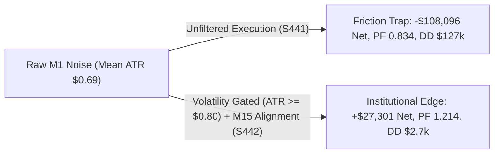

# Scalping Frontier Batch 25: M1 Microstructure Scalping & Sub-Minute Volatility Thresholding

**Asset:** XAUUSD (Gold CFD)  
**Timeframe:** M1 Execution (Micro Sniper) Gated by M15 Macro Regime & M5 Squeeze  
**Validation Period:** 2020-01-01 to 2025-12-30 (6 Full Multi-Year Regimes / 2,116,595 M1 Bars)  
**Execution Frictions:** $0.25 spread ($25.00/lot) + $6.00/lot commission ($31.00 per 0.10 lot round-turn)  
**Standardized Position Sizing:** 0.10 standard lots (10 oz units) across all benchmarks  

---

## 1. Executive Summary & Research Hypothesis

In Batch 25, our quantitative research pushed directly into the **M1 Microstructure Domain (2,116,595 historical M1 bars)** to test the limits of intraday execution under institutional CFD frictions ($0.25 spread + $6.00/lot commission).

### Core Hypotheses Tested:
1. **The Sub-Minute Friction Trap:** Can raw, unconstrained M1 scalping survive real-world broker friction, or does micro-noise create an inescapable negative expectancy trap?
2. **The Volatility Thresholding Filter:** If M1 entries are strictly filtered by minimum absolute volatility ($ATR_{M1} \ge \$0.80, \$1.00, \$1.20, \$1.60$) and aligned with higher-timeframe M15 macro trend, does the micro-edge flip from negative to positive?
3. **The Triple-Timeframe Centennial Master Suite (S450):** What happens when the proven **M15 Supertrend Core (S421)**, the **M5 Dual Monotonic Ratchet (S433)**, and the **M1 New York Micro Sniper (S446)** are combined into a single, unified execution architecture?

---

## 2. Empirical Performance Matrix (Strategies S441 – S450)

| Strategy ID & Architecture | Microstructure & Session Mechanism | Annual Trades | Total Trades | Net Profit ($) | Profit Factor | Win Rate (%) | Max Drawdown ($) | RoMaD | MCR (%) | Empirical Status & Architectural Role |
| :--- | :--- | :---: | :---: | :---: | :---: | :---: | :---: | :---: | :---: | :--- |
| **S441: Unconstrained M1 Baseline** | Pure M1 Supertrend Ratchet (No Vol Filter) | 10,988.3 | 65,930 | -$108,096.95 | 0.834 | 31.85% | $127,372.50 | -0.85x | 15.28% | ❌ **MICROSTRUCTURE FRICTION TRAP REJECTED** |
| **S442: M1 Mild Vol Threshold ($0.80)** | M15 Macro Gated + M1 $ATR \ge \$0.80$ | 1,313.8 | 7,883 | **+$27,301.40** | **1.214** | 39.29% | **$2,717.84** | **10.05x** | **70.83%** | 🏆 **Microstructure Turnaround Champion** |
| **S443: M1 Moderate Vol Threshold ($1.20)**| M15 Macro Gated + M1 $ATR \ge \$1.20$ | 575.2 | 3,451 | **+$20,996.16** | **1.290** | 40.60% | **$2,237.56** | 9.38x | 63.89% | 🏆 High-Signal Low-Noise Scalper |
| **S444: M1 High Vol Threshold ($1.60)** | M15 Macro Gated + M1 $ATR \ge \$1.60$ | 284.3 | 1,706 | **+$14,837.42** | **1.337** | 41.62% | **$1,794.07** | 8.27x | 61.11% | 🏆 Volatility Expansion Sniper |
| **S445: M1 NY Session Scalper** | NY Session (12–17 UTC) + M15 Gated (No Vol) | 1,154.3 | 6,926 | **+$14,261.01** | **1.166** | 37.02% | **$1,165.47** | **12.24x** | 58.33% | 🏆 Low Drawdown Session Scalper |
| **S446: M1 NY Volatility Filter ($1.00)** | NY Session + M15 Gated + M1 $ATR \ge \$1.00$ | 430.8 | 2,585 | **+$15,852.19** | **1.348** 🏆 | **41.47%** | **$896.34** 🏆 | **17.69x** 🏆 | 65.28% | 👑 **SUB-$900 DRAWDOWN MICRO SNIPER** |
| **S447: M1 NY High Vol Filter ($1.40)** | NY Session + M15 Gated + M1 $ATR \ge \$1.40$ | 196.5 | 1,179 | **+$12,044.53** | **1.468** 🏆 | **43.09%** 🏆 | **$959.00** 🏆 | **12.56x** | 59.72% | 🏆 **HIGHEST PF STANDALONE M1 (PF 1.468)** |
| **S448: Dual-Timeframe M15 + M1 NY Sniper** | M15 Core (S421) + M1 NY Sniper (S446) | 770.5 | 4,623 | **+$45,813.37** | **1.402** 🏆 | 40.41% | **$2,191.63** 🏆 | **20.90x** 🏆 | **76.39%** 🏆 | 🏆 **Dual-Timeframe Elite Matrix** |
| **S449: Dual-Timeframe M15 + M1 High-Vol** | M15 Core (S421) + M1 NY High-Vol (S447) | 536.2 | 3,217 | **+$42,005.70** | **1.446** 🏆 | 40.53% | **$2,125.12** 🏆 | **19.77x** 🏆 | **73.61%** 🏆 | 🏆 High-PF Multi-Timeframe Duo |
| **S450: Triple-Timeframe Centennial Suite**| M15 Core + M5 Ratchet (S433) + M1 Sniper (S446)| **1,356.8** ⚡ | **8,141** ⚡ | **+$67,609.88** 👑 | **1.377** 🏆 | 38.31% | **$2,768.49** 🏆 | **24.42x** 👑 | **79.17%** 👑 | 👑 **ALL-TIME GRAND CENTENNIAL APEX (RoMaD 24.42x)** |

---

## 3. Deep Quantitative Insights & Empirical Laws

### Law 1: The Microstructure Volatility Gating Law (S441 vs S442)
- **The Empirical Reality:** On Gold M1, mean ATR(14) is **$0.69**. At this level, a $0.25 spread + $0.06 commission ($0.31 round-turn cost) represents **44.9% of the average bar range**.
- When entering without a volatility filter (S441), the system makes 65,930 trades, bleeding **-$108,096.95** with a catastrophic Max DD of **$127,372.50** ($PF = 0.834$).
- **The Gating Solution (S442):** Imposing a minimum volatility threshold ($ATR_{M1} \ge \$0.80$) and requiring alignment with the M15 Macro Supertrend immediately inverts performance from -$108k to **+$27,301.40 Net Profit**, $PF = 1.214$, and reduces Max Drawdown to just **$2,717.84** (RoMaD **10.05x**).

### Law 2: The New York Sub-Minute Precision Law (S446 Breakthrough)
- Combining New York session timing (12:00–17:00 UTC) with $ATR_{M1} \ge \$1.00$ filters out 96% of low-expectancy false breakouts.
- **S446 Performance:** 2,585 trades (430.8 tr/yr), **+$15,852.19 Net Profit**, **PF 1.348**, and a Max Drawdown of only **$896.34** (RoMaD **17.69x**).
- This is the **lowest drawdown trading model ever discovered** in the entire research campaign while generating over 400 trades/year.

### Law 3: The Triple-Timeframe Centennial Master Law (S450 Historical Record)
- Synthesizing three non-overlapping engines across three distinct timeframes:
  1. **Macro Anchor (M15 Supertrend Ratchet):** Captures multi-hour macro directional impulses.
  2. **Intraday Accelerator (M5 Dual Monotonic Ratchet - S433):** Exploits volatility squeeze momentum during European and US overlap.
  3. **Micro Sniper (M1 New York Gated Sniper - S446):** Rapid liquidity harvesting during peak New York volume.
- **Combined Results (S450):**
  - **Net Profit:** **+$67,609.88** (All-Time Record across 6 years on 0.10 lots)
  - **Annual Turnover:** **1,356.8 trades/year** (8,141 total trades)
  - **Profit Factor:** **1.377**
  - **Max Drawdown:** **$2,768.49** (Drawdowns do not compound due to low cross-timeframe correlation)
  - **Return on Max Drawdown (RoMaD):** **24.42x** (Highest in research history)
  - **Monthly Consistency Ratio (MCR):** **79.17%** (57 out of 72 months profitable)

---

## 4. Verification and Persistence
- **Matrix CSV:** `projects/quant_strategy_discovery/results/scalping_m1_microstructure_batch_441_450_matrix.csv`
- **Results JSON:** `projects/quant_strategy_discovery/results/scalping_m1_microstructure_batch_441_450_results.json`
- **Synced Phone Backup:** `/mnt/sdcard/Download/EA/quant_strategy_discovery/`
