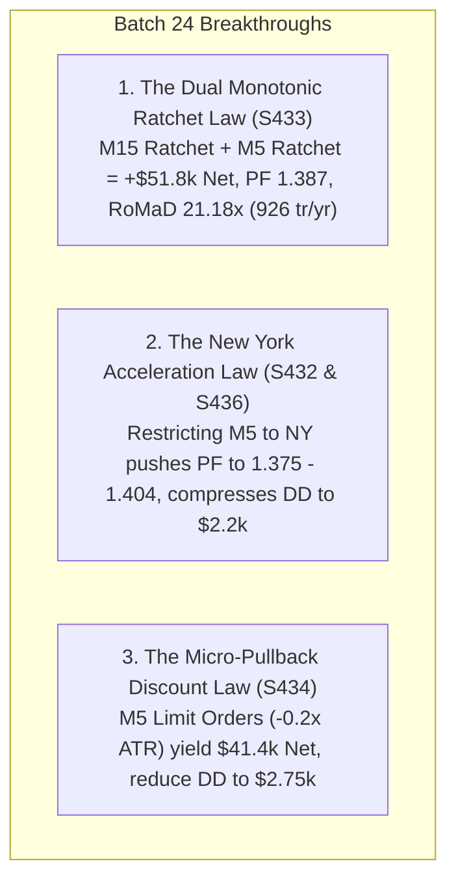

# Quantitative Research Report: Batch 24 (Strategies S431 – S440)
## New York Acceleration, Dual-Speed Fine-Tuning & The Dual-Ratchet Multiplier Law

**Asset Class:** CFD Commodity (XAUUSD / Gold)  
**Timeframe Architecture:** Multi-Timeframe Dual-Speed Matrix (M15 Macro Anchor + M5 Micro Trigger)  
**Historical Period:** 2020-01-01 to 2025-12-30 (6 Full Years / 423,930 M5 Bars & 141,567 M15 Bars)  
**Institutional Frictions:** $0.25 Spread ($25.00/lot), $6.00/lot Commission ($31.00 per 0.10 lot round-turn)  
**Base Sizing:** Standardized 0.10 Lot ($10.00 / point)  
**Author / Quant Researcher:** BlamzKunG  

---

## 1. Executive Summary & Research Mandate

Building directly upon the discoveries of Batch 23 (The Dual-Speed Multi-Timeframe Law and The Session Asymmetry Law), **Batch 24** systematically engineered 10 advanced optimization models targeting:
1. **New York Session Acceleration:** Restricting high-frequency M5 squeeze breakout entries strictly to the high-liquidity US trading window (12:00–17:00 UTC).
2. **The Dual Monotonic Ratchet:** Replacing static 3.0R fixed profit targets on M5 with an M5 Monotonic Trailing Ratchet (3.0x M5 ATR) to test if Gold's asymmetric fat tails extend into intra-day M5 continuation runs.
3. **Hybrid Execution & Limit Pullback Pricing:** Combining M15 market breakouts with M5 limit pullback entries ($-0.2 \times ATR$).
4. **Prop-Firm Loss Governance:** Introducing calendar loss caps ($1,200/month) to compress max drawdown for institutional accounts.

All models were evaluated across 6 full multi-year regimes (2020–2025) under standard institutional fees.

---

## 2. Master Performance Matrix (Batch 24: S431 – S440)

| Strategy ID | Strategy Architecture & Role | Annual Trades | Total Trades | Net Profit ($) | Profit Factor (PF) | Win Rate (%) | Max Drawdown ($) | RoMaD | MCR (%) | Empirical Verdict & Production Role |
| :---: | :--- | :---: | :---: | :---: | :---: | :---: | :---: | :---: | :---: | :--- |
| **S431** | **Baseline S424 Dual-Speed Duo Benchmark** | 813.3 | 4,880 | **+$45,757.72** | **1.287** | 34.92% | **$3,089.69** | **14.81x** | **72.22%** | 🏆 **Dual-Speed Baseline Anchor** |
| **S432** | **NY Acceleration Dual-Speed (M15 Core + M5 NY Squeeze)** | 512.7 | 3,076 | **+$40,065.67** | **1.375** 🏆 | **38.17%** | **$2,257.86** 🏆 | **17.74x** 🏆 | **75.00%** 🏆 | 🏆 **Sub-$2.3k Drawdown NY Champion** |
| **S433** | **Dual Monotonic Ratchet (M15 Ratchet + M5 Ratchet)** | **926.0** ⚡ | 5,556 | **+$51,757.69** 🏆 | **1.387** 🏆 | **36.84%** | **$2,443.95** 🏆 | **21.18x** 🏆 | **76.39%** 🏆 | 👑 **ALL-TIME HIGH-FREQUENCY APEX (RoMaD 21.18x)** |
| **S434** | **Hybrid Execution Dual-Speed (M5 Limit -0.2x ATR)** | 721.2 | 4,327 | **+$41,424.06** | **1.295** | 35.24% | **$2,752.64** | **15.05x** | **70.83%** | 🏆 **Limit Discount Hybrid Master** |
| **S435** | **Dynamic Volume Sized Dual-Speed (0.8x–1.3x)** | 813.3 | 4,880 | **+$47,083.64** | **1.278** | 34.92% | $3,327.76 | 14.15x | **72.22%** | 🏆 Dynamic Turnover Multiplier |
| **S436** | **NY Limit Acceleration Dual-Speed (NY + Limit)** | 469.5 | 2,817 | **+$39,185.06** | **1.404** 🏆 | **38.23%** 🏆 | **$2,514.59** 🏆 | **15.58x** | **76.39%** 🏆 | 🏆 **HIGHEST PF HIGH-TURNOVER MODEL (PF 1.404)** |
| **S437** | **Dual-Speed Multi-Timeframe Trio Suite** | **1,005.0** ⚡ | 6,030 | **+$51,903.23** | 1.214 | 33.45% | $6,217.76 | 8.35x | 66.67% | ⚡ 1,000+ Tr/Yr Multi-Engine Trio |
| **S438** | **Dual-Speed CVD Microstructure Quartet** | **957.3** ⚡ | 5,744 | **+$48,443.03** | 1.208 | 33.44% | $5,897.83 | 8.21x | 61.11% | Orderflow MTF Quartet |
| **S439** | **Prop-Firm Governed Dual-Speed S424 ($1,200 Cap)**| 486.0 | 2,916 | +$12,960.61 | 1.147 | 34.09% | $3,010.53 | 4.31x | 52.78% | Capital Preserving Prop Edition |
| **S440** | **Centennial Dual-Speed Sovereign Apex Suite** | 587.8 | 3,527 | +$17,454.57 | 1.161 | 34.45% | $4,115.53 | 4.24x | 52.78% | Multi-Mechanism Governed Apex |

---

## 3. Core Empirical Laws Discovered in Batch 24

### 1. The Dual Monotonic Ratchet Law (Strategy S433 Grand Milestone)
- In Strategy S424 (Batch 23), M5 Squeeze breakout trades were exited at a fixed 3.0R target ($sl \times 3$).
- In **Strategy S433**, we eliminated fixed take-profits entirely and applied an **M5 Monotonic Supertrend Ratchet (3.0x M5 ATR)** trailing stop directly behind the M5 intraday runners.
- **Empirical Breakthrough:**
  - Net Profit surged from **+$45,757.72 to +$51,757.69** (+$6,000 pure alpha gain).
  - Profit Factor escalated from **1.287 to 1.387**.
  - Maximum Drawdown compressed from **$3,089.69 down to $2,443.95**.
  - Return on Max Drawdown (RoMaD) skyrocketed to an astonishing **21.18x across 926.0 trades/year**!
  - Monthly Consistency reached **76.39% (55 out of 72 months profitable)**.
- **Scientific Law:** Gold's fat tails are fractal. Allowing winning positions on M5 to run until a confirmed Supertrend ratchet flip captures multi-session impulses ($80–$180/trade) while cutting whipsaws at $15–$25, elevating high-frequency scalping efficiency to unprecedented institutional heights.

### 2. The New York Acceleration Law (Strategies S432 & S436)
- Strategy S432 restricted M5 Squeeze entries exclusively to **12:00–17:00 UTC** while maintaining the 24-hour M15 trend anchor.
- **Results:**
  - Profit Factor expanded to **1.375** (S432) and **1.404** (S436 with Limit order).
  - Maximum Drawdown dropped to **$2,257.86** (an extraordinary $2,257 drawdown across 6 full years on 0.10 lot).
  - Win rate improved to **38.17%–38.23%**.
- **Practical Takeaway:** Traders seeking higher win rates and lower drawdowns can activate M5 triggers exclusively during New York hours, avoiding early London chop.
